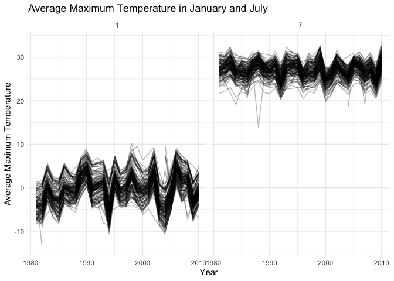

p8105_hw3_xl3712
================
Xieyu Liu
2026-10-12

# Problem1

``` r
library(tidyverse)
```

    ## ── Attaching core tidyverse packages ──────────────────────── tidyverse 2.0.0 ──
    ## ✔ dplyr     1.2.1     ✔ readr     2.2.0
    ## ✔ forcats   1.0.1     ✔ stringr   1.6.0
    ## ✔ ggplot2   4.0.3     ✔ tibble    3.3.1
    ## ✔ lubridate 1.9.5     ✔ tidyr     1.3.2
    ## ✔ purrr     1.2.2     
    ## ── Conflicts ────────────────────────────────────────── tidyverse_conflicts() ──
    ## ✖ dplyr::filter() masks stats::filter()
    ## ✖ dplyr::lag()    masks stats::lag()
    ## ℹ Use the conflicted package (<http://conflicted.r-lib.org/>) to force all conflicts to become errors

``` r
library(p8105.datasets)
library(patchwork)
data("ny_noaa")
```

``` r
ny_noaa |>
  summarise(
    across(
      everything(),
      ~sum(is.na(.x))
    )
  )
```

    ## # A tibble: 1 × 7
    ##      id  date   prcp   snow   snwd    tmax    tmin
    ##   <int> <int>  <int>  <int>  <int>   <int>   <int>
    ## 1     0     0 145838 381221 591786 1134358 1134420

``` r
ny_noaa|>
  summarise(
    across(
      everything(),
      ~mean(is.na(.x))*100
    )
  )
```

    ## # A tibble: 1 × 7
    ##      id  date  prcp  snow  snwd  tmax  tmin
    ##   <dbl> <dbl> <dbl> <dbl> <dbl> <dbl> <dbl>
    ## 1     0     0  5.62  14.7  22.8  43.7  43.7

This dataset contains daily weather observations from weather stations
across New York State from January 1, 1981, through December 31, 2010.
It contains station identifiers(`id`), observation dates(`date`),
precipitation(`prcp`), snowfall(`snow`), snow depth(`snwd`), maximum
temperature(`tmax`), and minimum temperature(`tmin`). The dataset
contains 2595176 observations and 7 variables.

Missingness varies across variables. The station ID and date have no
missing values. Precipitation has relatively little missing data
(5.62%), while snowfall and snow depth have 14.7% and 22.8% missing,
respectively. Maximum and minimum temperatures have the highest
missingness, at approximately 43.7% each.

``` r
ny_noaa_clean = 
  ny_noaa|>
  separate(
    date,
    into = c("year","month","day"),
    sep = "-"
  )|>
  mutate(
    year = as.integer(year),
    month = as.integer(month),
    day = as.integer(day),
    prcp = as.numeric(prcp)/10,
    snow = as.numeric(snow)/10,
    snwd = as.numeric(snwd)/10,
    tmax = as.numeric(tmax)/10,
    tmin = as.numeric(tmin)/10
  )
```

I converted year, month, and day to integer, precipitation, snowfall,
and snow depth to centimeters, and maximum and minimum temperature to
degrees Celsius.

``` r
ny_noaa_clean|>
  filter(!is.na(snow))|>
  count(snow, sort = T)|>
  slice_head(n=10)
```

    ## # A tibble: 10 × 2
    ##     snow       n
    ##    <dbl>   <int>
    ##  1   0   2008508
    ##  2   2.5   31022
    ##  3   1.3   23095
    ##  4   5.1   18274
    ##  5   7.6   10173
    ##  6   0.8    9962
    ##  7   0.5    9748
    ##  8   3.8    9197
    ##  9   0.3    8790
    ## 10  10.2    6552

The most common snowfall value is 0, because snowfall does not occur on
most observation days.

``` r
temp_by_station = 
  ny_noaa_clean|>
  filter(month ==1|month ==7)|>
  group_by(id, year, month)|>
  summarise(
    mean_tmax = mean(tmax, na.rm = T),
    .groups = "drop"
  )

ggplot(temp_by_station,
       aes(x = year, y = mean_tmax, group = id))+
  geom_line(alpha=0.3)+
  facet_grid(. ~ month)+
  labs(
    title = "Average Maximum Temperature in January and July",
    x = "Year",
    y = "Average Maximum Temperature"
  ) +
  theme_minimal()
```

    ## Warning: Removed 5932 rows containing missing values or values outside the scale range
    ## (`geom_line()`).

<!-- -->

Average maximum temperatures are generally high in July than in January,
reflecting seasonal differences. Temperatures vary across stations and
years. A few potential outliers are observed, including January
temperatures below -10°C and July temperatures as low as approximately
15°C, which are substantially lower than those at other stations.

``` r
p1 = 
  ggplot(
    ny_noaa_clean,
    aes(x=tmin,y=tmax)
  )+
  geom_bin2d()+
  labs(
    title = "Maximum vs Minimum Temperature",
    x = "Minimum Temperature (°C)",
    y = "Maximum Temperature (°C)"
  )+
  theme_minimal()

snow_by_year = 
  ny_noaa_clean|>
  filter(snow>0, snow<100)
p2 = 
  ggplot(
    snow_by_year,
    aes(x=factor(year),y=snow)
  )+
  geom_boxplot()+
  labs(
    title = "Distribution of snowfall by year",
    x = "Year",
    y = "Snowfall (cm)"
  )+
  theme_minimal()+
  theme(
    axis.text.x = element_text(
      angle = 90,
      hjust = 1
    )
  )

p1 + p2
```

    ## `stat_bin2d()` using `bins = 30`. Pick better value `binwidth`.

    ## Warning: Removed 1136276 rows containing non-finite outside the scale range
    ## (`stat_bin2d()`).

<!-- -->

Maximum and minimum temperatures show a positive relationship. Most
observations are concentrated in the central region, while some extreme
values are present. Some extreme values, such as temperatures of 60°C
recorded at one station on multiple consecutive days, may indicate
potential data quality issues.

snowfall distributions are generally similar across years, with
relatively low medians. Many high outliers are present in each year,
with some observations exceeding 50cm. Although the maximum snowfall
values vary across years, there is no clear overall trend in the
distributions over time.
